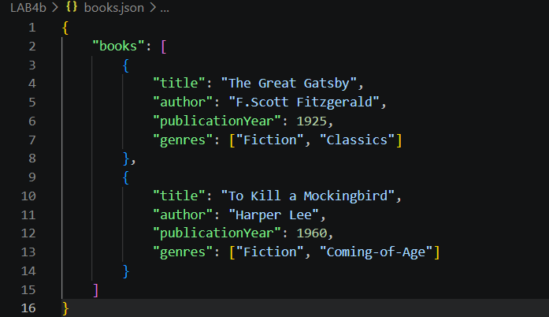
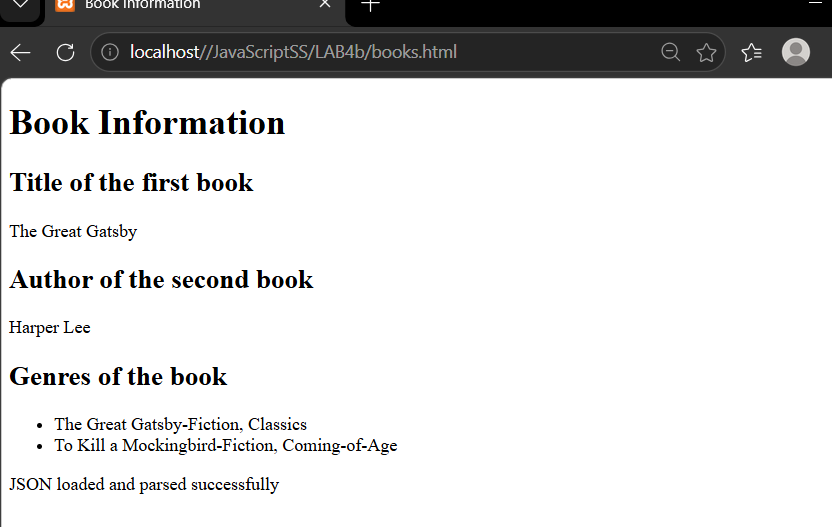
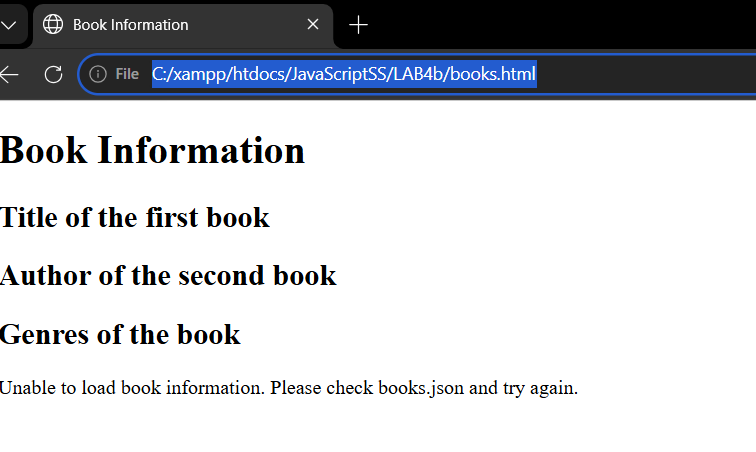
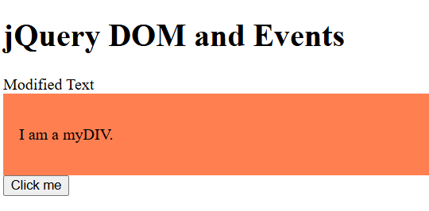
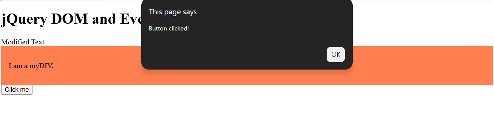

# Lab 4b: JSON and jQuery

## Student Details
- Name: Fitrah Zakiah Binti Faisal
- Student ID: AI240088
- Course: BIC21203 Web Development
- Section: 7

## Description
This lab covers creating JSON data, loading it using JavaScript fetch(), and using jQuery to update webpage elements and handle button clicks.

## Question 1: Create JSON Data
The books.json file contains a books array with two book objects.
Each book includes a title, author, publication year and an array of genres.

## Question 2: Retrieve and Display JSON Data
The books.html page loads books.json using fetch().
It displays the first book's title, the second book's author and both books' genres.
An error message is displayed if the file cannot be loaded or the JSON is invalid.

## Question 3: jQuery DOM and Events
The jquery-dom.html page uses:
- .text() to change Original Text to Modified Text.
- .addClass() to apply a coral background and padding.
- .on("click", ...) to display a Button clicked! alert.

## How to Run Using XAMPP
1. Download and extract this repository.
2. Put the project folder inside C:\xampp\htdocs.
3. Open XAMPP Control Panel and start Apache.
4. Open http://localhost/YOUR-FOLDER-NAME/books.html.
5. Open http://localhost/YOUR-FOLDER-NAME/jquery-dom.html.
6. Keep an internet connection available to load jQuery from its CDN.

Replace YOUR-FOLDER-NAME with the actual project folder name.
Do not open books.html directly using file:// because it loads a local JSON file.

## Screenshots

### Q1: JSON Data

### Q2: Book Information

### Q2: Error Handling

### Q3: Text and Style Changes

### Q3: Button Click

